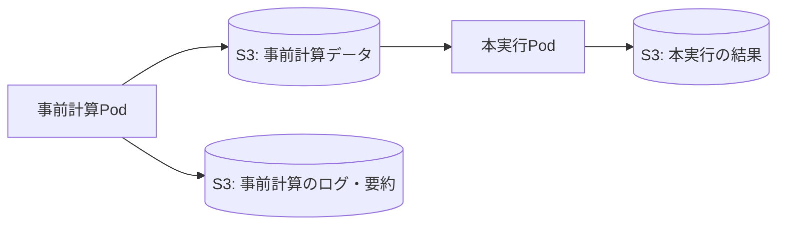

# 事前計算付き実験の実行

1回の実験は、事前計算と本実行の2段階で構成します。
対象はこのリポジトリのテンプレートに従ったJava／Pythonエージェントと、`ghcr.io/shima004/rcrs-server:v1.0.4` です。

## 実行の順序

1. 事前計算ステップのPodでS3からマップZIPを取得し、シードとモジュール設定を反映する。
2. サーバーを `precompute` モードで起動し、準備完了後に各種類のエージェントを事前計算モードで接続する。
3. 全種類の正常終了と生成データを確認してサーバーを停止する。
4. 種類別の事前計算データをZIPにまとめ、S3へ保存する。事前計算の要約とログも別に保存する。
5. 事前計算ステップが成功したら、本実行ステップを新しいPodで開始する。
6. S3から事前計算データとマップを取得し、実行ID・マップのハッシュ・制限時間を検証する。
7. サーバーを `comprun --nogui` で起動し、復元した事前計算データを使ってエージェントを起動する。
8. 全platoonエージェントの事前計算済みモードでの接続を確認し、結果をS3へ保存する。



Argoでは各実行に `precompute` と `simulation` の2ステップを作ります。各ステップは別PodのContainerSetです。
各Podにはシミュレーター1コンテナ、エージェント3コンテナ（消防・警察・救急）、結果収集1コンテナを配置します。
消防署は消防、警察署は警察、救急センターは救急と同じコンテナで起動します。
`emptyDir` は各Pod内だけで共有します。ステップ間はS3上の `precompute/data.zip` を介して受け渡します。
ZIP内のマニフェストで実行ID・計画上のrun ID・元マップZIPのSHA-256・共通の期限を照合します。別実行のデータや、事前計算後に変更されたマップは受け付けません。
本実行は取得したデータのコピーを使い、保存元へ書き込む権限を持ちません。実験間のキャッシュ共有は行いません。
CPU・メモリはシミュレーターと種類別の各コンテナに指定値を適用し、各ステップを順番に起動するため、同じ実行で2段階分を同時に確保しません。
`resources` は種類ごとの既定値、`resourcesByRole` は種類別の上書きです。上書きを省略した場合も3種類のコンテナを作成するため、エージェント全体には既定値の3倍を確保します。別途、結果保存用コンテナに0.1 CPU・256Miを割り当てます。

事前計算では、マップに存在する各platoon種別について1体ずつ接続します。全種類の正常終了と生成データのS3保存が完了してから、本実行ステップへ進みます。
本実行では `map/scenario.xml` に記載された各種別の数と、対応するセンターの数を接続します。マップに存在しない種類はプロセス起動を省略します。
いずれかの種類が失敗した場合はサーバーと他の種類の処理も中止し、失敗結果を保存します。
Javaは `PRECOMPUTED`、Pythonは構造化ログの `mode: 1`（PRECOMPUTED）を確認します。ログ形式はテンプレートが対象とするADFの版に依存します。
事前計算データは `/work/precompute/<role>/`、解決後のモジュール設定は `/work/modules/<role>/` に分けます。Javaの `/app/precomp_data` は種類専用領域へのリンク、Pythonは `launcher.yaml` で種類専用領域を指定します。
ログも `agent-fire-brigade.log` など種類別のファイルに分けます。結果要約の `agents` に種類別の成功・失敗、`agent` に全種類の集約状態を保存します。

## マップZIPの形式

名前と版を付けて管理する場合は [マップの登録と利用](maps.md) を参照してください。登録済みマップは実験送信時に版とSHA-256を固定します。`simulator.parameters.timesteps` でステップ数を指定でき、マップの登録し直しは不要です。

ZIPのルートに以下を配置します。

```text
map/
  map.gml
  scenario.xml
config/
  kernel.cfg
  common.cfg
  その他、includeで参照される設定ファイル
```

サーバーのマップ配布物全体をこの形式で保存してください。単一GMLファイルだけでは実行できません。
相対パスの外へ出るエントリ、シンボリックリンク、重複パス、2GiBを超えるアーカイブ・展開結果は受け付けません。
`random.seed` は展開した設定内で上書きします。元のS3オブジェクトには変更を加えません。

## イメージの準備

エージェントは [Java](../templates/agents/java/README.md) または [Python](../templates/agents/python/README.md) のテンプレートでビルドし、実行ノードからpullできるレジストリに登録します。
ワーカーはこのリポジトリのルートでビルドします。

```sh
docker build -t registry.example.com/simworkflow/worker:v1 .
docker push registry.example.com/simworkflow/worker:v1
```

HTTPレジストリへの登録ではDockerデーモンの設定に応じて追加の対応が必要です。
デーモン設定を変えずに登録する場合の例:

```sh
go install github.com/google/go-containerregistry/cmd/crane@v0.22.1
docker save -o /tmp/simworkflow-worker.tar registry.example.com/simworkflow/worker:v1
crane push --insecure /tmp/simworkflow-worker.tar registry.example.com/simworkflow/worker:v1
```

実行するKubernetesノード側も、そのレジストリへ接続できる必要があります。
現在の実行テンプレートは `linux/amd64` を対象にします。Java版は起動時にGradleをofflineモードで使用するため、依存ライブラリを含むテンプレートイメージを使ってください。

## Argoの実行権限

CLIの作成・参照権限は [client-rbac.yaml](../examples/kubernetes/client-rbac.yaml)、実行Podのexecutor権限は [executor-rbac.yaml](../examples/kubernetes/executor-rbac.yaml) を参照してください。
既存のRoleBindingで同等の権限があれば追加は不要です。CLIはこれらの設定を自動適用しません。

## 送信と結果の確認

実験YAMLの `runtime` に `java` または `python` を指定します。イメージ、マップのS3参照、モジュール候補は実際に用意したものを指定してください。

```sh
go run ./cmd/simworkflow experiment submit \
  -f experiment.yaml \
  --service-account simworkflow

# submitが返したWorkflow名を指定。オプションは名前より前に置く
go run ./cmd/simworkflow experiment status --watch WORKFLOW_NAME
go run ./cmd/simworkflow experiment results WORKFLOW_NAME
```

`status --watch` は約5秒ごとに構成別の段階・状態・完了ステップ数／総ステップ数・最新スコア・進捗の更新経過時間を表示します。`status` 単体は1回だけ表示します。
端末上の `status --watch` はスクロール可能なTUIです。上下キー／`j`・`k`で実行を選択します。選択行には `>` が付き、画面外へ移動すると自動でスクロールします。行のクリックでも選択できます。マウスホイールでスクロール、PageUp・PageDownでページ移動、Home・Endで先頭・末尾へ移動できます。左右キー／`h`・`l`で横方向にもスクロールできます。実験名と列名は画面上部に固定し、更新時も選択とスクロール位置を維持します。端末サイズの変更にも追従します。
Enterで選択した実行の設定詳細を開きます。送信済みの `plan.json` から、実験・構成ID、マップの確定した版・取得元・SHA256、シード、イメージ、シミュレーションのステップ数、CPU・メモリ、種類別リソースの適用値、展開済みモジュール構成、並列数・タイムアウト・収集対象を表示します。詳細も上下・左右・ページ・ホイールでスクロールでき、EscまたはBackspaceで一覧の選択位置に戻ります。手元のYAMLを後から変更しても、この表示には反映されません。
詳細画面で `w` を押すと、選択中の実行をSimScopeで開きます。実行中はリアルタイム接続、終了後は保存ログの再生になります。接続先の設定、対応ワーカー、ネットワーク条件は [SimScope連携](simscope.md) を参照してください。
完了後も最終結果を表示し、`q`・Ctrl+Cで画面を閉じます。一覧ではEscでも終了できます。実行中に閉じても実験は停止しません。詳細を開いている間も進捗の取得は継続します。通信エラー時は直前の表示を残して再取得します。
従来のテキスト表示には `status --watch --plain WORKFLOW_NAME` を使います。標準入力・標準出力が端末でない場合や `TERM=dumb` の場合もテキスト表示になり、Workflowの完了時に終了します。オプションはWorkflow名より前に指定してください。
進捗対応ワーカーで新規送信した実験では、結果収集コンテナがカーネルログを追跡し、段階ごとの `progress.json` を約5秒ごとにS3へ送信します。表示には転送・ポーリング分の遅延があります。完了ステップ数はカーネルの完了ログから読み、経過時間からは推定しません。
旧ワーカーの実験や未起動のPodではステップ数を `-` と表示します。初期化中は進捗の送信前なので、まずArgoの段階・状態だけが表示されます。進捗転送が止まった場合は最終更新からの経過時間を確認できます。進捗送信の失敗だけで実験を失敗にはしません。

`results` は実験ごとの要約をJSON配列で返します。実行状態、モジュール構成、シード、事前計算ファイル、スコア、S3の保存先を確認できます。
`stage` が要約の対象（`precompute`／`simulation`）、`phase` がその段階の結果、`workflowPhase` がWorkflow全体の状態です。
本実行の要約がまだない場合は事前計算の要約を返します。事前計算のSucceededは実験全体の完了を意味しません。
スコアは本実行の `kernel.log` に記録された最後の `Score:` または `Score=` の数値です。取得できない場合は `score` を省略し、値を推測しません。

`experiment download` で要約・ログ・設定・事前計算データを選んで取得できます。構成・段階・ログ単体での絞り込みは [ダウンロード手順](download.md) を参照してください。

S3では実行ごとに一意のプレフィックスを生成します。

```text
experiments/<execution-id>/plan.json
experiments/<execution-id>/<run-id>/precompute/progress.json
experiments/<execution-id>/<run-id>/progress.json
experiments/<execution-id>/<run-id>/precompute/data.zip
experiments/<execution-id>/<run-id>/precompute/summary.json
experiments/<execution-id>/<run-id>/precompute/bundle.tar.gz
experiments/<execution-id>/<run-id>/summary.json
experiments/<execution-id>/<run-id>/bundle.tar.gz
```

各段階のバンドルにはその段階の要約、事前計算データ、解決後のモジュール設定、シード反映後のサーバー設定、状態ファイルを保存します。
エージェントログ・サーバーログは `outputs.collect` の指定に従って追加します。
ワーカー開始後の失敗やタイムアウトでも結果保存を試みます。Pod自体の起動・イメージ取得・準備処理に失敗した場合や、強制削除・保存先への通信失敗では要約を保存できないため、Argoの状態を確認してください。

## 生成YAMLの確認

```sh
mkdir -p artifacts
go run ./cmd/simworkflow experiment render \
  -f experiment.yaml \
  --output artifacts/workflow.yaml
```

`render` はS3オブジェクトの存在確認、期限付きURLの発行、実行計画のS3保存を行います。Argoには送信しません。
出力ファイルは0600で新規作成し、既存ファイルは上書きしません。
このファイルはそのままArgoへ送信でき、有効期限内は対象オブジェクトへのアクセス権を持ちます。Gitへの登録・共有は避けてください。`artifacts/` はGitとDockerの対象から除外しています。

PodにはS3の長期アクセスキーやArgoのトークンを渡しません。CLIが段階ごとに必要な署名付きURLを発行します。事前計算にはマップのGET・事前計算データと段階別結果のPUT、本実行にはマップと事前計算データのGET・本実行結果のPUTを渡します。
署名URLの有効期限は24時間です。1実行20時間まで、計画上の総所要時間23時間までに制限します。キュー待ちで期限を超えた場合や元の一時認証情報が早く失効した場合は、再送信が必要です。
URLを含むワーカー設定は結果バンドルに含めません。

## 大きな実験のWorkflowサイズ

実行数が多い場合は `render`／`submit` に `--config-storage s3` を追加します。段階ごとのワーカー設定をS3の `experiments/<execution-id>/configs/<run-id>/<stage>.json` に保存し、Workflowには当該設定のGET用署名付きURLだけを渡します。ワーカーは起動時に設定を取得します。100実行でも事前計算・本実行を分け、同じWorkflow内で指定した並列数を維持します。

```sh
go run ./cmd/simworkflow experiment submit \
  -f examples/validation/rescue-python-vc-100/experiment.yaml \
  --config-storage s3
```

`s3` 方式はCLI既定の公開helperイメージで利用できます。独自のhelperに切り替える場合は `remote-config-20261024` 以降に相当する設定取得機能が必要です。このワーカーは進捗・SimScope用Pod IPの保存にも対応します。設定取得の署名URLも24時間有効で、Podに長期アクセスキーは渡しません。設定オブジェクトには他の転送用URLも含まれるため、バケットは非公開で管理します。設定オブジェクトは結果バンドルや通常の結果ダウンロードには含めません。

既定の `--config-storage inline` は従来どおり設定JSONをWorkflowに埋め込み、旧ワーカーと互換性があります。CLIは生成定義が900KiBを超える場合、Argoへ送信する前にエラーにします。これはノード状態用の余裕を残すための検査で、クラスタ側のWorkflowサイズ制限は変更しません。

## タイムアウト

`execution.timeout` は事前計算Podの準備開始から本実行完了までの合計時間です。S3転送と、ステップ間のキュー待ちも含みます。
共通の期限を引き継ぐため、本実行の開始・再試行で制限時間はリセットしません。
各Podには保存猶予として指定時間に180秒を加えた上限を設定します。Workflow全体の期限は実行波数×（指定時間＋360秒）です。
`maxParallelRuns` は同時実行Pod数を制限します。

## 本実行だけの再試行

本実行ステップには `retryPolicy: Always`、追加1回の再試行を設定しています。ArgoがFailedまたはErrorと判定した場合に、本実行だけを最大1回再試行します。
再試行では新しいPodへ同じ事前計算データを取得し、事前計算ステップは再実行しません。結果の要約・バンドルは同じ本実行の保存先を更新します。
期限切れや署名付きURLの失効後は再試行できないため、実験を新しく送信してください。

実験YAMLの項目は従来どおりです。段階別のCPU・メモリ・タイムアウト指定や、異なる実験間での事前計算キャッシュ共有は今後の拡張です。
