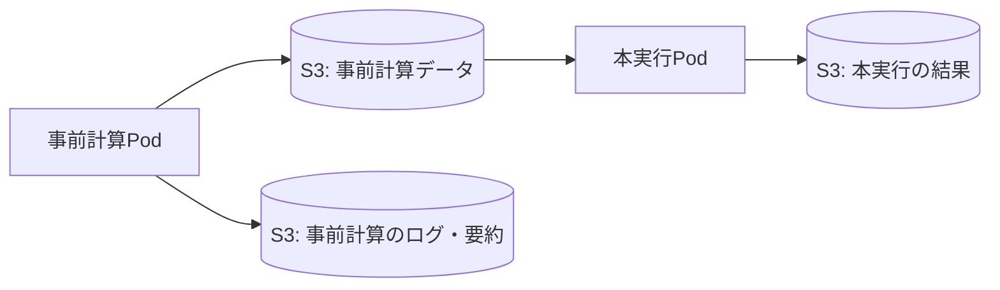

# 実験の実行と結果保存

1実行（1構成 × 1マップバージョン × 1シード）は、事前計算と本実行の2段階で動きます。このページでは、実行順序、必要なリソース、結果の保存と再試行、送信時の制限を説明します。最初の操作手順は [クイックスタート](quickstart.md) を参照してください。

## 実行の順序



1. 事前計算（`precompute`）：マップを取得し、シードとモジュール設定を反映してシミュレーター・エージェントを起動する。
2. 全種類のエージェントの正常終了を確認し、事前計算データ、要約、収集対象のログをS3へ保存する。
3. 本実行（`simulation`）：別のPodで同じマップと事前計算データを取得し、事前計算済みモードで実行する。
4. 最終スコアを取得し、要約と収集対象のログをS3へ保存する。結果保存まで終わると、その段階が完了する。

事前計算が失敗した実行は本実行へ進みません。1つの実行が失敗しても、他の実行は継続します。全体の終了時に、1つでも最終的に失敗した実行があればWorkflowも失敗になります。成功分の結果は引き続き取得できます。

事前計算ではマップに存在する消防・警察・救急の各種類から1体ずつ、本実行ではマップに記載された全個体と署・センターを接続します。Java／Pythonエージェントは [テンプレート](agent-build.md) に従ったイメージを使ってください。標準の実行環境は `linux/amd64` です。

事前計算データは実行ID・run ID・マップのハッシュ・共通の期限と照合します。別の実行のデータは使えません。実験間での事前計算キャッシュ共有には対応していません。

## コンテナとリソース

各段階は別Podで動きます。各Podにはシミュレーター、消防・警察・救急、結果収集のコンテナを配置します。署・センターは対応する種類と同じコンテナで動き、各種類の全個体でリソースを共有します。

| 対象 | 実験YAMLの設定 | 省略時 |
| --- | --- | --- |
| シミュレーター | `spec.simulator.resources` | CPU・メモリとも必須 |
| エージェントの各種類 | `spec.agents[].resources` | CPU・メモリとも必須。3種類にそれぞれ適用 |
| 種類ごとの上書き | `spec.agents[].resourcesByRole` | そのエージェントの `resources` を使用 |
| 結果収集 | `spec.execution.collectorResources` | 1 CPU・256Mi |

1 Podの主な要求量は「シミュレーター ＋ エージェント3種類 ＋ 結果収集」です。さらにArgo executorなどの分も必要です。事前計算と本実行は順番に起動するため、同じ実行で2段階分を同時には確保しません。`maxParallelRuns` は同時実行Pod数の上限です。

準備用のinitコンテナには0.1 CPU・256Miを指定します。CPU・メモリの設定方法と計算例は [実験YAML](experiment-yaml.md#cpuメモリ) を参照してください。

## 送信と結果の確認

```sh
simworkflow experiment validate -f experiment.yaml
simworkflow experiment plan -f experiment.yaml
simworkflow experiment submit -f experiment.yaml --service-account simworkflow

# 送信時に表示された名前へ置き換える
simworkflow experiment status --watch WORKFLOW_NAME
simworkflow experiment results WORKFLOW_NAME
simworkflow experiment download --include summary --stage simulation WORKFLOW_NAME
```

実行用ServiceAccountは管理者が用意したものを指定します。進捗・スコアの読み方は [実験の管理・進捗](progress.md)、必要なログの取得は [ダウンロード](download.md) を参照してください。

## 送信準備の進捗

`submit`・`render` は、マップのバージョン解決、イメージのdigest固定、マップの検査と再現用保存、実行設定の生成を済ませてからWorkflowを作成します。CLIからレジストリの読み取りとS3の読み書きが必要です。

準備の進捗は標準エラー出力に表示します。`Resolve map catalog` は登録マップの解決、`Verify and snapshot maps` はマップの検査と保存、`Submit workflow to Argo` はArgoへの送信です。容量が分かる転送には割合を表示します。並列処理中のバーは、現在表示している転送の進捗です。

マップの取得・検査は最大8件を並列処理します。これは送信準備用の並列数で、シミュレーションの `maxParallelRuns` とは別です。保存済みの同一内容のマップは検証して再利用します。詳しくは [入力の確定と再利用](reproduction.md#入力を確定する時点と制限) を参照してください。

送信結果が不明なままコマンドが終了した場合は、`experiment list` でWorkflowの有無を確認してから再実行してください。同じYAMLの `submit` は、その都度新しい実験を作ります。

## 生成YAMLの確認

```sh
mkdir -p artifacts
simworkflow experiment render -f experiment.yaml --output artifacts/workflow.yaml
```

`render` はArgoへ送信せず、生成したWorkflow定義を新しいファイルに保存します。**オフラインのプレビューではありません。** `submit` と同じ入力の検査・S3への保存を行います。条件と実行回数だけを確認したい場合は `plan` を使います。

出力ファイルは0600で新規作成し、上書きしません。期限付きの署名付きURLを含み、有効期限内は対象オブジェクトへアクセスできるため、Gitへの登録・共有は避けてください。PodにはS3の長期アクセスキーやArgoトークンを渡さず、段階ごとに必要なURLを渡します。

## 結果の保存

結果は設定したS3バケットに保存します。ローカルへ取得するには `experiment download` を使います。`outputs.collect` で、必要なスコアとログを送信前に選んでください。

```text
experiments/<execution-id>/
  plan.json                         # 送信時に確定した実行計画
  reproduction.json                 # 入力の固定情報
  <run-id>/
    precompute/
      progress.json
      data.zip                      # 本実行へ渡す事前計算データ
      summary.json
      bundle.zip                    # 事前計算の結果一式
    progress.json
    summary.json                    # 本実行の要約・スコア
    bundle.zip                      # 本実行の結果一式
reproduction/maps/<sha256>.zip       # 再現用マップ
```

各段階のバンドルには要約、事前計算データ、解決後のモジュール設定、シード・ステップ数を反映したサーバー設定、状態ファイルを保存します。ログは `outputs.collect` で指定した対象を含めます。旧helperの結果は `bundle.tar.gz` です。CLIは両形式を読み取れます。ZIPでは必要なファイルだけを部分取得できます。

ワーカー開始後の失敗やタイムアウトでも結果保存を試みます。イメージ取得・準備処理の失敗、Podの強制削除、S3への通信失敗などでは要約やログを保存できない場合があります。この場合はArgoの状態とPodの終了理由を確認してください。

## 完了Podの自動削除

新しく生成するWorkflowは、成功・失敗を問わず、完了して削除待ちになったPodを10分後に削除します。`submit`・`render`・`retry`・`reproduce` で共通です。

削除後もS3に収集済みの結果は取得できます。収集対象から外したログや、OOM・強制終了・通信失敗で保存できなかったログは、Pod削除後に取得できなくなります。Podのログや終了理由を直接調べる場合は、削除前に確認してください。

CLIはWorkflow自体の自動削除期限（`ttlStrategy`）を設定しません。クラスタ側の既定値がある場合は管理者へ確認してください。進捗・結果取得・再送信にはArgo APIでWorkflowを参照できる必要があるため、必要な結果や再現用ZIPを削除前に保存します。

## タイムアウトと署名付きURLの期限

`execution.timeout` は事前計算Podの準備開始から本実行完了までの合計時間です。S3転送とステップ間の待機も含み、本実行の開始・再試行でリセットしません。結果保存の猶予として各Podには180秒を加えた上限を設定します。

署名付きURLは発行時から7日間有効です。送信時は次の見積もりを167時間以下に制限し、期限まで1時間の余裕を残します。

```text
ceil(総実行数 / maxParallelRuns) × (timeout + 6分)
```

上限を超えた場合は、実験を分割する、タイムアウトを見直す、クラスタの容量に合わせて並列数を増やす、といった調整を行います。並列数を増やしても、Podを配置できなければ実際の待ち時間は減りません。

キュー待ちでURLの期限を超えた場合や、一時認証情報が先に失効した場合は、新しいURLを発行するために再送信が必要です。

## 失敗と再試行

本実行がArgoで `Failed` または `Error` になると、本実行だけを最大1回自動再試行します。新しいPodで同じ事前計算データを使い、事前計算はやり直しません。本実行の要約とバンドルは同じ保存先を更新します。共通の制限時間やURLの期限を過ぎると、この再試行も完了できません。

`experiment retry` は終了済みWorkflowの失敗分を新しいWorkflowへ送信します。こちらは事前計算からやり直し、新しい実行IDと署名付きURLを作ります。対象の確認、設定の引き継ぎ、結果の統合は [再送信ガイド](retry.md) を参照してください。

## ワーカー設定とWorkflowサイズ

通常は既定の `--config-storage auto` を使います。CLIがhelperの対応状況からS3上の保存形式を選びます。独自helper・旧helperを使う場合だけ、次の指定を検討してください。

| 指定 | 動作・用途 |
| --- | --- |
| `auto`（既定） | `s3-sequence` → `s3-bundle` → `s3` の順に対応形式を選ぶ |
| `s3-sequence` | 段階別の設定ZIPを使い、同じイメージ・リソースの実行を連番展開する。多数の実行でも定義サイズを抑えられる |
| `s3-bundle` | 段階別の設定ZIPを使い、各実行をrun IDで指定する |
| `s3` | 実行・段階ごとに個別の設定JSONを保存する。バンドル非対応helper向け |
| `inline` | 設定JSONをWorkflowに埋め込む。S3から設定取得できない旧helper向け |

`s3-bundle` にはhelperの `io.simworkflow.config-bundle=v1`、`s3-sequence` にはさらに `io.simworkflow.config-sequence=v1` の対応が必要です。非対応形式を明示するとエラーになります。タグやラベルを変更するだけでは機能は追加できません。既定のhelperを使うか、[独自helper](distribution.md#独自helperをビルドする) を更新してください。

設定バンドルは段階ごとに分かれ、各Podは自分の段階のZIP全体を取得します。設定オブジェクトを途中で変更・削除すると、後続Podや再試行が起動できなくなります。設定には署名付きURLを含むため、S3バケットは非公開で管理します。通常のダウンロードや再現用ZIPにはワーカー設定を含めず、自動削除もしません。

実行件数の固定上限はありませんが、次の容量制限があります。

| 対象 | 上限 |
| --- | --- |
| 生成するWorkflow定義 | 900KiB。超過時は送信前にエラー |
| 設定バンドル | 圧縮後64MiB・展開合計256MiB |
| 1実行・1段階の設定 | 1MiB |
| 設定バンドル内のマニフェスト | 4MiB |

イメージやリソースの異なる組み合わせが多いと、定義も大きくなります。制限を超えた場合は実験を分割してください。定義が小さくてもArgoのノード状態は実行数に応じて増えるため、大規模実験の前に管理者が [ノード状態の退避](distribution.md#大規模な実験のための設定) を設定します。

[ドキュメント一覧へ](README.md)
