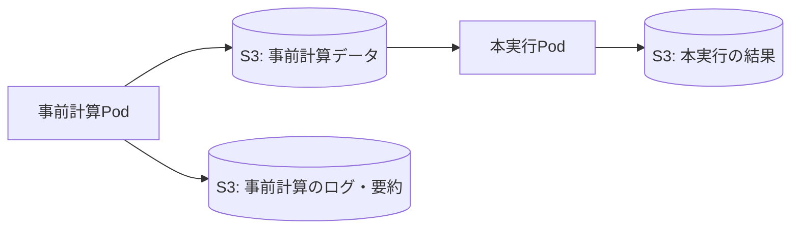

# 実験の実行と結果保存

1回の実験は、事前計算と本実行の2段階で構成します。
対象はこのリポジトリのテンプレートに従ったJava／Pythonエージェントと、`ghcr.io/shima004/rcrs-server:v1.0.4` です。

## 実行の順序

1. 事前計算ステップのPodでS3からマップZIPを取得し、シードとモジュール設定を反映する。
2. サーバーを `precompute` モードで起動し、準備完了後に各種類のエージェントを事前計算モードで接続する。
3. 全種類の正常終了と生成データを確認してサーバーを停止する。
4. 種類別の事前計算データをZIPにまとめ、S3へ保存する。事前計算の要約とログも別に保存する。
5. 事前計算ステップが成功したら、本実行ステップを新しいPodで開始する。
6. S3から事前計算データとマップを取得し、実行ID・マップのハッシュ・制限時間を検証する。
7. サーバーを `comprun --nogui` で起動し、復元した事前計算データを使ってエージェントを起動する。
8. 全platoonエージェントの事前計算済みモードでの接続を確認し、結果をS3へ保存する。



Argoでは各実行に `precompute` と `simulation` の2ステップを作ります。各ステップは別PodのContainerSetです。
各Podにはシミュレーター1コンテナ、エージェント3コンテナ（消防・警察・救急）、結果収集1コンテナを配置します。
消防署は消防、警察署は警察、救急センターは救急と同じコンテナで起動します。
`emptyDir` は各Pod内だけで共有します。ステップ間はS3上の `precompute/data.zip` を介して受け渡します。
ZIP内のマニフェストで実行ID・計画上のrun ID・元マップZIPのSHA-256・共通の期限を照合します。別実行のデータや、事前計算後に変更されたマップは受け付けません。
本実行は取得したデータのコピーを使い、保存元へ書き込む権限を持ちません。実験間のキャッシュ共有は行いません。

## コンテナとリソース

CPU・メモリはシミュレーターと種類別の各コンテナに指定値を適用し、各ステップを順番に起動するため、同じ実行で2段階分を同時に確保しません。
`resources` は種類ごとの既定値、`resourcesByRole` は種類別の上書きです。上書きを省略した場合も3種類のコンテナを作成するため、エージェント全体には既定値の3倍を確保します。別途、結果保存用コンテナに0.1 CPU・256Miを割り当てます。

## エージェントの起動とデータ

事前計算では、マップに存在する各platoon種別について1体ずつ接続します。全種類の正常終了と生成データのS3保存が完了してから、本実行ステップへ進みます。
本実行では `map/scenario.xml` に記載された各種別の数と、対応するセンターの数を接続します。マップに存在しない種類はプロセス起動を省略します。
いずれかの種類が失敗した場合はサーバーと他の種類の処理も中止し、失敗結果を保存します。
Javaは `PRECOMPUTED`、Pythonは構造化ログの `mode: 1`（PRECOMPUTED）を確認します。ログ形式はテンプレートが対象とするADFのバージョンに依存します。
事前計算データは `/work/precompute/<role>/`、解決後のモジュール設定は `/work/modules/<role>/` に分けます。Javaの `/app/precomp_data` は種類専用領域へのリンク、Pythonは `launcher.yaml` で種類専用領域を指定します。
ログも `agent-fire-brigade.log` など種類別のファイルに分けます。結果要約の `agents` に種類別の成功・失敗、`agent` に全種類の集約状態を保存します。

## 実行前に用意するもの

接続設定、エージェントイメージ、登録済みマップを用意します。最初の送信は [クイックスタート](quickstart.md)、クラスタ・バケット・helperの準備は [実行環境の準備](distribution.md) を参照してください。

エージェントは [Java](../templates/agents/java/README.md) または [Python](../templates/agents/python/README.md) のテンプレートに従って作成します。標準の実行環境は `linux/amd64` です。Javaエージェントは起動時にGradleをofflineモードで使用するため、依存ライブラリを含むテンプレートイメージを使います。

## Argoの実行権限

CLIの作成・参照権限は [client-rbac.yaml](../examples/kubernetes/client-rbac.yaml)、実行Podのexecutor権限は [executor-rbac.yaml](../examples/kubernetes/executor-rbac.yaml) を参照してください。
既存のRoleBindingで同等の権限があれば追加は不要です。CLIはこれらの設定を自動適用しません。

## 送信と結果の確認

実験YAMLの `runtime` に `java` または `python` を指定します。イメージ、マップのS3参照、モジュール候補は実際に用意したものを指定してください。

```sh
simworkflow experiment submit \
  -f experiment.yaml \
  --service-account simworkflow

# submitが返したWorkflow名を指定。オプションは名前より前に置く
simworkflow experiment status --watch WORKFLOW_NAME
simworkflow experiment results WORKFLOW_NAME
```

進捗の表示・TUI操作・スコアの読み方は [進捗・スコアの確認](progress.md)、ログや要約の取得は [ダウンロード](download.md) を参照してください。

## 結果の保存

S3では実行ごとに一意のプレフィックスを生成します。

```text
experiments/<execution-id>/plan.json
experiments/<execution-id>/reproduction.json
experiments/<execution-id>/<run-id>/precompute/progress.json
experiments/<execution-id>/<run-id>/progress.json
experiments/<execution-id>/<run-id>/precompute/data.zip
experiments/<execution-id>/<run-id>/precompute/summary.json
experiments/<execution-id>/<run-id>/precompute/bundle.tar.gz
experiments/<execution-id>/<run-id>/summary.json
experiments/<execution-id>/<run-id>/bundle.tar.gz
reproduction/maps/<sha256>.zip
```

各段階のバンドルにはその段階の要約、事前計算データ、解決後のモジュール設定、シード反映後のサーバー設定、状態ファイルを保存します。
エージェントログ・サーバーログは `outputs.collect` の指定に従って追加します。
ワーカー開始後の失敗やタイムアウトでも結果保存を試みます。Pod自体の起動・イメージ取得・準備処理に失敗した場合や、強制削除・保存先への通信失敗では要約を保存できないため、Argoの状態を確認してください。

## 生成YAMLの確認

```sh
mkdir -p artifacts
simworkflow experiment render \
  -f experiment.yaml \
  --output artifacts/workflow.yaml
```

`render`／`submit` はイメージをlinux/amd64のdigestへ解決し、マップを検査してS3の内容別保存先へコピーします。再現用情報と実行計画の保存後、期限付きURLを発行します。CLIからレジストリの読み取りとS3の読み書きが必要です。`render` はArgoには送信しません。詳細は [再現用ZIP](reproduction.md) を参照してください。
出力ファイルは0600で新規作成し、既存ファイルは上書きしません。
このファイルはそのままArgoへ送信でき、有効期限内は対象オブジェクトへのアクセス権を持ちます。Gitへの登録・共有は避けてください。`artifacts/` はGitとDockerの対象から除外しています。

PodにはS3の長期アクセスキーやArgoのトークンを渡しません。CLIが段階ごとに必要な署名付きURLを発行します。事前計算にはマップのGET・事前計算データと段階別結果のPUT、本実行にはマップと事前計算データのGET・本実行結果のPUTを渡します。
署名URLの有効期限は発行時から7日間（168時間）です。1実行のタイムアウトに20時間の固定上限はありません。並列数と各実行のタイムアウト、各実行波の360秒の余裕から算出する計画上の総所要時間を167時間までに制限し、期限まで1時間の余裕を残します。キュー待ちで期限を超えた場合や元の一時認証情報が早く失効した場合は、再送信が必要です。
URLを含むワーカー設定は結果バンドルに含めません。

## ワーカー設定とWorkflowサイズ

`render`／`submit` はデフォルトで `--config-storage auto` を使用します。helperイメージに `io.simworkflow.config-bundle=v1` と `io.simworkflow.config-sequence=v1` があれば `s3-sequence`、バンドルだけに対応していれば `s3-bundle`、どちらも未対応なら従来の `s3` を選びます。バンドル未対応時には切り替えたことを表示します。設定はいずれも非公開のS3へ保存します。

S3方式では、同じイメージ・種類別CPU／メモリ・制限時間の実行が、事前計算・本実行・その実行順序を定義するテンプレートを共有します。モジュール・マップ・シードが違ってもコンテナ定義を複製しません。異なるイメージやリソース設定は別テンプレートになります。各実行は別々のPodで動き、同じWorkflow内で並列数、失敗の独立性、本実行だけの再試行を維持します。

```sh
simworkflow experiment submit \
  -f experiment.yaml
```

`s3-sequence` では、同じシミュレーター・エージェントのイメージと実効CPU／メモリを使う実行をグループ化し、グループごとに `withSequence` で0からの連番を展開します。エージェント名・モジュール・マップ・シードだけの違いではグループを分けません。シードは `42, 7, 123` のような任意の値で構いません。連番は保存された計画内のグループ別の順序を表し、バンドルの対応表から元のrun IDを選びます。

この方式も段階別のZIPを2つ使い、各Podには自分の段階のURL・SHA-256と、グループ名・グループ内の番号を渡します。helperはSHA-256を確認した後、対応表の重複・欠落・範囲外指定と、選択された実行のイメージ・リソースがグループに一致することを検証します。イメージや種類別CPU／メモリが違う場合は、同じWorkflow内に別のループを作ります。CLIは保存された計画からループ位置を解決するため、進捗・経過時間・SimScopeと結果保存では元のrun IDを維持します。Argo上の展開名はグループと連番になります。

グループ数が同じなら、Workflow定義は実行数を増やしてもほぼ同じ容量です。ただし計画・バンドル・実行中のノード状態・転送量は増えます。実行件数による固定上限はありませんが、圧縮後64MiB・展開合計256MiBのバンドル、1設定1MiB、対応表を含むマニフェスト4MiB、署名付きURLの期限による制約は残ります。件数制限の撤廃は、10万実行の動作保証を意味しません。

`s3-bundle` は、全実行の設定を段階別に `experiments/<execution-id>/configs/precompute.zip` と `simulation.zip` へまとめます。Workflowの共通パラメータに段階別URLとSHA-256を1つずつ持ち、実行ごとのタスクにはrun IDだけを渡します。helperは自分の段階のZIPを一時取得し、全体のSHA-256とZIPのパス・サイズ・マニフェストを確認してから、自分のrun IDのJSONだけを読みます。実行ID・段階・事前計算データの読み書き権限が一致しなければ起動しません。バンドルは圧縮後64MiB、展開合計256MiB、1設定1MiBまでです。実行件数の固定上限はありません。一時ZIPは0600で作成し、取得・検証終了時に削除します。

バンドル方式では各Podが同じ段階の他の実行設定も読めます。そのため、事前計算と本実行のバンドルを分け、各Podには自分の段階のURLだけを渡します。各Podが段階全体のZIPを取得するため、実行数に応じてダウンロード量も増えます。設定バンドルを変更・削除すると後続Podや再試行が起動できません。

`s3` を明示すると従来どおり、段階ごとのJSONを `experiments/<execution-id>/configs/<run-id>/<stage>.json` に保存し、各run IDのタスクから専用の設定URLを渡します。バンドル非対応helperでも利用できます。`s3-bundle`／`s3-sequence` を明示して非対応helperを指定すると、互換性エラーにします。既存の公開helperを指定しても、イメージ自体が自動更新されることはありません。新しいhelperはこのリポジトリのDockerfileからビルドするか、対応するReleaseに同梱されたdigestを使用してください。能力ラベルだけを古いイメージへ付けても対応にはなりません。

設定取得の署名URLは7日間有効で、Podに長期アクセスキーは渡しません。設定には他の転送用URLも含まれるため、バケットは非公開で管理します。設定オブジェクトは結果バンドル・通常の結果ダウンロード・再現用ZIPには含めず、自動削除は行いません。再現実行時は保存された方式に従って、現在の接続先で設定を新しく生成します。

`--config-storage inline` を明示すると従来どおり設定JSONをWorkflowに埋め込み、旧ワーカーを使用できます。CLIは生成定義が900KiBを超える場合、Argoへ送信する前にエラーにします。これはノード状態用の余裕を残すための検査で、クラスタ側のWorkflowサイズ制限は変更しません。

### 実行中のノード状態が大きくなる場合

定義の共通化後も、実行中のノード状態は実行数に応じて増えます。大規模な実験では、ArgoのSQL接続を設定し、`nodeStatusOffLoad: true` を有効にします。Helmでは既存の `controller.persistence` に追加します。

```yaml
controller:
  persistence:
    nodeStatusOffLoad: true
    # 既存のpostgresqlなどの接続設定は維持する
```

`archive: true` による終了したWorkflowの保存とは別機能です。既存のDB接続が正常なら、その接続を利用できます。ノード状態の退避は定義そのものを小さくしないため、CLIのサイズ検査は維持します。実行数や設定URLの長さ、異なるイメージ・リソースの組み合わせによっては、共通化後も定義サイズの上限に達します。

CLIはArgo Server APIから取得したノード状態を使って進捗・経過時間・SimScopeの接続先を判定します。直接Kubernetesリソースだけを読む構成にはしません。設定の詳細は [Argoの公式ガイド](https://argo-workflows.readthedocs.io/en/release-4.1/offloading-large-workflows/) を参照してください。

## タイムアウト

`execution.timeout` は事前計算Podの準備開始から本実行完了までの合計時間です。S3転送と、ステップ間のキュー待ちも含みます。
共通の期限を引き継ぐため、本実行の開始・再試行で制限時間はリセットしません。
各Podには保存猶予として指定時間に180秒を加えた上限を設定します。Workflow全体の期限は実行波数×（指定時間＋360秒）です。
`maxParallelRuns` は同時実行Pod数を制限します。

## 失敗と再試行

1つの実行が失敗しても、他の構成の実行は継続します。失敗した事前計算の本実行は開始しません。全体は各実行の終了を待ち、1つでも最終的に失敗した実行があればWorkflowも失敗になります。保存済みの成功結果は引き続き参照・取得できます。

### 本実行だけの再試行

本実行ステップには `retryPolicy: Always`、追加1回の再試行を設定しています。ArgoがFailedまたはErrorと判定した場合に、本実行だけを最大1回再試行します。
再試行では新しいPodへ同じ事前計算データを取得し、事前計算ステップは再実行しません。結果の要約・バンドルは同じ本実行の保存先を更新します。
期限切れや署名付きURLの失効後は再試行できないため、実験を新しく送信してください。

段階別のCPU・メモリ・タイムアウト指定や、異なる実験間での事前計算キャッシュ共有は今後の拡張です。

[ドキュメント一覧へ](README.md)
